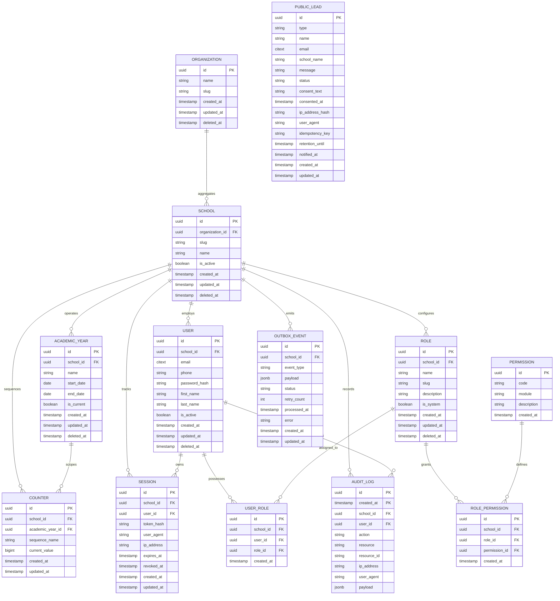

# ProgressEye Phase 11 Entity-Relationship Diagram (ERD)

## Overview
This diagram models the database schema for Phase 11 multi-tenancy foundation in `progresseye-api`. Every tenant-scoped entity enforces `school_id NOT NULL UUID` and PostgreSQL Row-Level Security (RLS).

